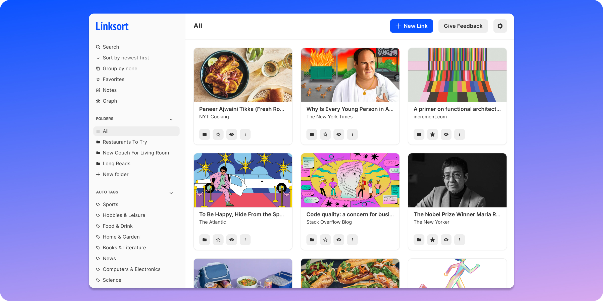

# Linksort

[](https://circleci.com/gh/linksort/linksort/tree/main) [](https://linksort.com/docs/index.html)



Linksort is an open source bookmarking application.

## Development

Setting up your development environment is easy. Make sure you have [`docker`](https://docs.docker.com/get-docker/) and [`docker-compose`](https://docs.docker.com/compose/install/) installed and run the following command from the root of this repository.

```bash
docker compose up
```

That's it! Go to [http://localhost:8000](http://localhost:8000) to find the app up and running. Whenever you change a file, the code we be automatically recompiled and run.

---

Sometimes you need to develop without being inside a Docker container. Follow these steps to run the project in development mode without Docker.

You'll need a access to a mongodb endpoint that supports replica sets. You can build and run a docker image that provides such an endpoint by running the following commands.

```bash
# Build the image.
docker build -f docker/mongo.Dockerfile -t mongo-rs .

# Run it in the background.
docker run -p 27017:27017 -v db-data:/data/db -d mongo-rs
```

Run [`air`](https://github.com/air-verse/air) to start the backend server. This also starts a watcher that automatically rebuilds and runs the server whenever changes are detected. You'll also need to set the following environment variables.

```bash
export PRODUCTION=0
export ANALYZER_KEY=$(cat /path/to/key)  # Optional
export DIFFBOT_TOKEN="<YOUR KEY>"
export ANTHROPIC_API_KEY="<YOUR KEY>"
export FRONTEND_HOSTNAME=localhost
export FRONTEND_PORT=3000
air
```

For the AI chat features, the backend needs AWS credentials with Bedrock access. In production it assumes the role in `LOG_PUTTER`; locally, leave `LOG_PUTTER` unset and the server uses the default AWS credential chain instead. Note that the Go SDK cannot read credentials from the browser-based `aws login` flow — if that's what you use, export them as plain environment variables before starting `air`:

```bash
unset LOG_PUTTER
eval "$(aws configure export-credentials --format env)"
air
```

Open another terminal window and start the frontend. This server also starts a watcher that supports hot module replacement.

```bash
cd frontend
yarn start
```

Go to [http://localhost:8080](http://localhost:8080).

### Running Tests

```bash
# Build the mongo image.
docker build -f docker/mongo.Dockerfile -t mongo-rs .

# Run it. Note db-data2 and db2.
docker run -p 27017:27017 -v db-data2:/data/db2 -d mongo-rs

# Run tests. No need to repeat the previous steps for subsequent runs.
go test ./...

# Frontend unit tests (jest; CI=true makes it non-interactive).
cd frontend
CI=true yarn test
```

The mock Bedrock client used by the Go tests (`testutil/mock_bedrock.go`) streams a fixed reply by default, but tests can script multi-turn replies, including tool calls, with `testutil.Bedrock().SetScript(...)` (see `integ/link_review_test.go` for examples).

### Running in Prod Mode Locally

```bash
docker build -f ./docker/main.Dockerfile -t ls .
docker run -e ANALYZER_KEY="$ANALYZER_KEY" -e DB_CONNECTION="mongodb://172.17.0.2:27017/?connect=direct" -p 8080:8080 ls
```

### Generating API Docs

```bash
# Make sure swag is installed (the version must match go.mod).
go install github.com/swaggo/swag/cmd/swag@v1.8.10

# Generate docs.
swag init --dir cmd/serve/,handler,model,payload,agent
```

## AI Chat Features

### Automatic Link Reviews

When a user returns to the app **with the AI chat pane visible** (the desktop chat column: a viewport of at least 1536px with the panel toggled on), the frontend calls `POST /api/conversations/review`. If the chat pane is hidden or the viewport is too narrow, no request is made and nothing is consumed — the review simply happens on a later visit when the pane is visible.

If the user has at least **3** links created since their last review and at least **4 hours** have passed since it (constants in `controller/conversation.go`), the server creates a `link_review` conversation, stamps `User.LastLinkReviewAt` (server-managed; not settable via `PATCH /api/users`), and responds `201`; otherwise it responds `204` and nothing happens. The frontend then issues `PUT /api/conversations/{id}/converse` with `{"trigger": "link_review"}` (no message), which builds a hidden synthetic user message (`kind: "link_review_trigger"`) containing the new links as compact JSON (capped at the **40** most recent) and streams the assistant's review: a summary of what was saved, detected clusters, and folder-organization proposals that the user confirms before anything changes.

### Clickable Choice Prompts

When the assistant asks a question with a small, determinate set of answers, it ends its message with a fenced code block whose info string is `choices` (one option per line, 2–5 options, each ≤60 chars):

````
Want me to create a "Couch Options" folder?

```choices
Yes, do it
No thanks
```
````

The frontend (`frontend/src/utils/choices.js`) strips this block and renders the options as buttons under the message. Clicking one sends the option text verbatim as the user's next message; typing a free-form reply is always possible. Only the latest assistant message gets live buttons; answered prompts render inactive with the chosen option indicated.

### Testing Link Reviews Locally

To force a review for a user (e.g. after you've just saved some links), reset their review stamp and reload the app with the chat pane visible:

```bash
mongosh --quiet --eval 'db.getSiblingDB("test").users.updateOne(
  {email: "you@example.com"},
  {$set: {lastLinkReviewAt: new Date(Date.now() - 24*3600*1000)}})'
```

Set the stamp to a time *before* the links you want reviewed were created (links older than the stamp don't count). Using `$unset` instead treats all of the user's links as new (capped at 40).
